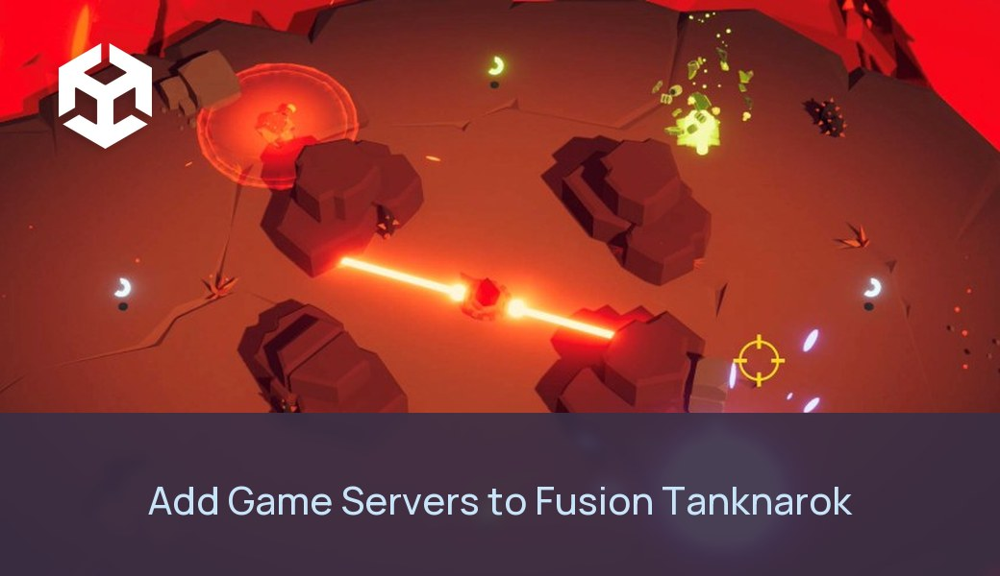

# Photon Fusion on Arbitrium

This guide will help you create a headless server on Edgegap for a Unity project using [Photon Fusion]( https://doc.photonengine.com/en-us/fusion/current/getting-started/fusion-intro) as its networking solution.

In this guide, we will be using the sample project [`Tanknarok` from Photon Fusion]( https://doc.photonengine.com/en-us/fusion/current/game-samples/fusion-tanknarok) as an example.

## Tutorial

You can see the [full documentation here](https://docs.edgegap.com/docs/sample-projects/photon-fusion-on-edgegap)

## Quick start

1. Open the project with Unity 2021.3 (Linux Build Support installed) and import the Photon Fusion 1 SDK if `Assets/Photon` is empty.
2. Create a Fusion app in the Photon dashboard with **Plugin Version "Fusion 1.1"** (a Fusion 2 App ID is refused with `Incompatible Configuration`) and put its App ID in `Assets/Photon/Fusion/Resources/PhotonAppSettings.asset`.
3. In the Edgegap dashboard create an application and an API token, then fill `AppName`, `Version` and `ApiToken` in `Assets/ScriptableObjects/EdgegapConfig.asset`. Keep the token out of git.
4. Build for Linux with the **Server** build target into `Builds/EdgegapServer`, then `docker build --platform linux/amd64 -t registry.edgegap.com/<project>/tanknarok:<tag> .` and push it.
5. Create the app version with one UDP port, `5050`, named `gameport` (port check off), 512 CPU units and 512 MB.

The server reads the `room_code` and `player_count` environment variables that the host client sends when it deploys. The full walkthrough is in the [documentation](https://docs.edgegap.com/docs/sample-projects/photon-fusion-on-edgegap).
